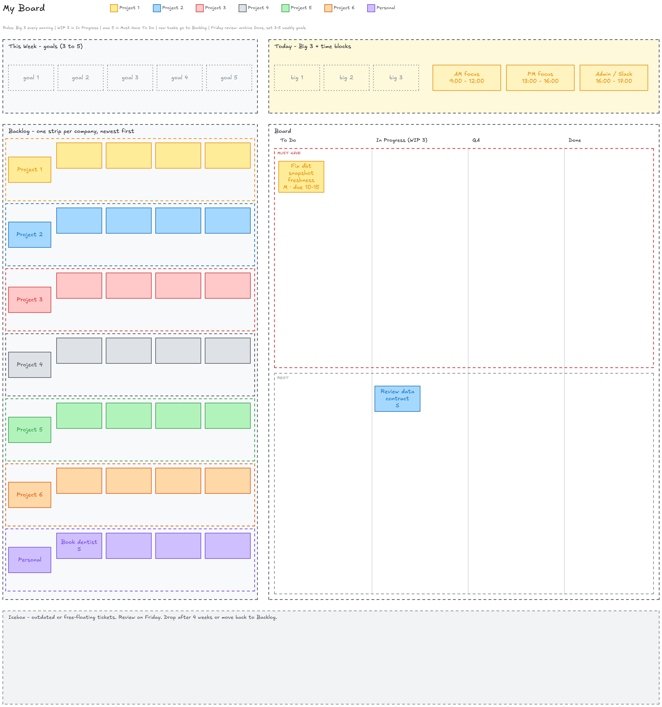

# excalidraw-local

Excalidraw как нативное приложение для Mac, плюс MCP-сервер, чтобы Claude Code рисовал на нём диаграммы.

```
Claude Code  --MCP-->  mcp_excalidraw  --HTTP-->  canvas server :3456  <--WebKit--  Excalidraw.app
```

## Что получаете

- `Excalidraw.app`: нативное окно macOS. Без вкладки браузера. При запуске поднимает canvas-сервер, при выходе останавливает.
- MCP-сервер, зарегистрированный в Claude Code. Просите диаграмму и смотрите, как она появляется.
- Рисунки сохраняются в `canvas-data/` между перезапусками.
- Экспорт `.excalidraw` файлов в любой репозиторий.

## Демо: Claude рисует дата-платформу

Один промпт в Claude Code. Диаграмма рисуется на canvas через MCP:

> Нарисуй типичную платформу для data engineering в Excalidraw: источники, ingestion, Snowflake со слоями RAW, STAGING, INTERMEDIATE и MARTS, dbt, оркестрация в Airflow, потребители BI, ML и AI, контроль качества данных. Экспортируй в `diagrams/`.


Файлы: [`diagrams/data-platform-architecture.excalidraw`](diagrams/data-platform-architecture.excalidraw) (редактируемый) и PNG выше.

Что Claude сделал внутри: создал около 50 элементов одной командой, снял скриншот без браузера, увидел две проблемы (лишняя надпись и стрелки через зону), исправил и экспортировал. Дальше результат можно править руками в приложении.

## Личная Kanban-доска

Тот же canvas работает как доска задач. Одна доска для всех компаний и личных дел, цвет на категорию, полосы Backlog, дорожка Must Have через To Do / In Progress / QA / Done, зона Today с Big 3 и цели на неделю.



- Добавить задачу из Claude Code: «add task Fix dbt snapshot for Project 1, size M». Или `node board/add-task.mjs --company p1 --title "Fix dbt snapshot" --size M`.
- `/board-plan-day` каждое утро выбирает Big 3. `/board-week-review` в пятницу архивирует Done и ставит цели на следующую неделю.
- Стикеры двигаете руками в приложении. Скрипты только добавляют.

Подробности и правила: [`board/README.md`](board/README.md).

## Библиотеки: стикеры и иконки облаков

При старте приложение загружает библиотеки Excalidraw из `libs/` в боковую панель: стикеры, иконки AWS, Azure, GCP и логотипы технологий. Claude тоже умеет их ставить:

```bash
node libs/stamp.mjs list s3
node libs/stamp.mjs add --item "S3" --x 400 --y 200
```

Подробности: [`libs/README.md`](libs/README.md).

### Примеры из каждой библиотеки

По шесть элементов из каждой библиотеки, отрисованных с canvas.

**Стикеры (Post-it)** · `libs/post-it.excalidrawlib`


**Простые стикеры** · `libs/simple-sticky-notes.excalidrawlib`


**Иконки архитектуры AWS** · `libs/aws-architecture-icons.excalidrawlib`


**Иконки AWS Serverless v2** · `libs/aws-serverless-icons-v2.excalidrawlib`


**Azure Compute** · `libs/azure-compute.excalidrawlib`


**Azure Storage** · `libs/azure-storage.excalidrawlib`


**Azure Network** · `libs/azure-network.excalidrawlib`


**Azure Containers** · `libs/azure-containers.excalidrawlib`


**Azure General** · `libs/azure-general.excalidrawlib`


**Иконки GCP** · `libs/gcp-icons.excalidrawlib`


**Иконки архитектуры Google** · `libs/original-google-architecture-icons.excalidrawlib`


**Логотипы технологий** · `libs/technology-logos.excalidrawlib`


**Паттерны облачной архитектуры** · `libs/cloud-design-patterns.excalidrawlib`


## Требования

- macOS 12 или новее
- Node.js 20 или новее
- Xcode command line tools (`xcode-select --install`)
- Claude Code CLI (опционально, для регистрации MCP)

## Установка

```bash
git clone --recurse-submodules https://github.com/surfalytics/excalidraw-local.git
cd excalidraw-local
./setup.sh
```

Потом откройте `Excalidraw.app`. Можно перетащить в Dock.

Держите репозиторий вне `~/Desktop`, `~/Documents` и `~/Downloads`. macOS не даёт приложениям, запущенным из Finder, читать эти папки.

## Использование

1. Откройте `Excalidraw.app`.
2. В Claude Code попросите: «Нарисуй архитектуру этого сервиса в Excalidraw».
3. Фигуры появляются в приложении в реальном времени.
4. Попросите Claude экспортировать `.excalidraw` файл. Диаграммы проекта кладите в `docs/` того репозитория. Остальные в `diagrams/`.
5. Save To в приложении открывает обычный диалог сохранения macOS.

## Структура

| Путь | Что это |
|---|---|
| `app-wrapper/` | Исходник на Swift, иконка, plist и `build.sh` для нативного приложения |
| `mcp_excalidraw/` | Сабмодуль. MCP-сервер и живой canvas. Форк [yctimlin/mcp_excalidraw](https://github.com/yctimlin/mcp_excalidraw) |
| `excalidraw/` | Сабмодуль. Исходники Excalidraw. Форк [excalidraw/excalidraw](https://github.com/excalidraw/excalidraw). Для работы не нужен |
| `canvas-data/` | Состояние canvas. В git не попадает |
| `diagrams/` | Сохранённые `.excalidraw` файлы |
| `setup.sh` | Разовая установка |
| `update.sh` | Обновить сабмодули и пересобрать |

## Обслуживание

| Задача | Команда |
|---|---|
| Обновить всё | `./update.sh` |
| Пересобрать только приложение | `./app-wrapper/build.sh` |
| Проверить статус MCP | `claude mcp get excalidraw` |
| Остановить зависший canvas | `pkill -f "mcp_excalidraw/dist/server.js"` |
| Работать с исходниками Excalidraw | `./setup.sh --source`, затем `cd excalidraw && corepack yarn start` |

## Заметки

- Порт 3456 выбран специально. Порт 3000 часто занят. Менять в `app-wrapper/main.swift` и в `setup.sh` одновременно.
- Если приложение не открыто, MCP-сервер сам поднимает canvas. Оба используют один `canvas-data/`.
- Приложение подписано ad-hoc. Если macOS блокирует, один раз откройте через правый клик и Open.
