# excalidraw-local

[Русская версия](README-RU.md)

Run Excalidraw on your Mac as a native app, and let Claude Code draw on it through MCP.

```
Claude Code  --MCP-->  mcp_excalidraw  --HTTP-->  canvas server :3456  <--WebKit--  Excalidraw.app
```

## What you get

- `Excalidraw.app`: a native macOS window. No browser tab. Starts the canvas server on launch and stops it on quit.
- MCP server registered in Claude Code. Ask for a diagram and watch it appear live.
- Drawings persist in `canvas-data/` between restarts.
- Export `.excalidraw` files into any repo.

## Demo: Claude draws a data platform

One prompt to Claude Code, drawn live on the canvas through MCP:

> Draw a typical data engineering platform in Excalidraw: sources, ingestion, Snowflake with RAW, STAGING, INTERMEDIATE and MARTS layers, dbt, Airflow orchestration, BI, ML and AI consumers, and data quality. Then export it to `diagrams-examples/`.

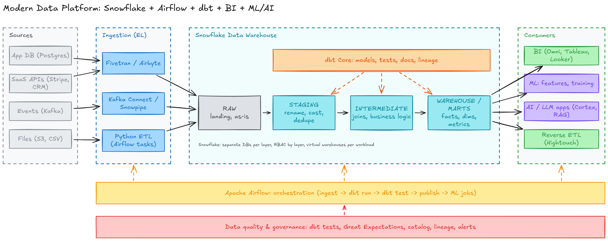

Files: [`diagrams-examples/data-platform-architecture.excalidraw`](diagrams-examples/data-platform-architecture.excalidraw) (editable) and the PNG above.

What Claude did under the hood: created about 50 elements in one batch, took a headless screenshot, saw two problems (a stray label and arrows crossing a zone), fixed them, and exported. You can then edit the result by hand in the app.

## Personal Kanban board

The same canvas also works as a task board. One board for every company and personal life, color per category, Backlog strips, a Must Have lane across To Do / In Progress / QA, Backlog strips on the left, Done strips on the right, a Today area with the Big 3, and weekly goals.

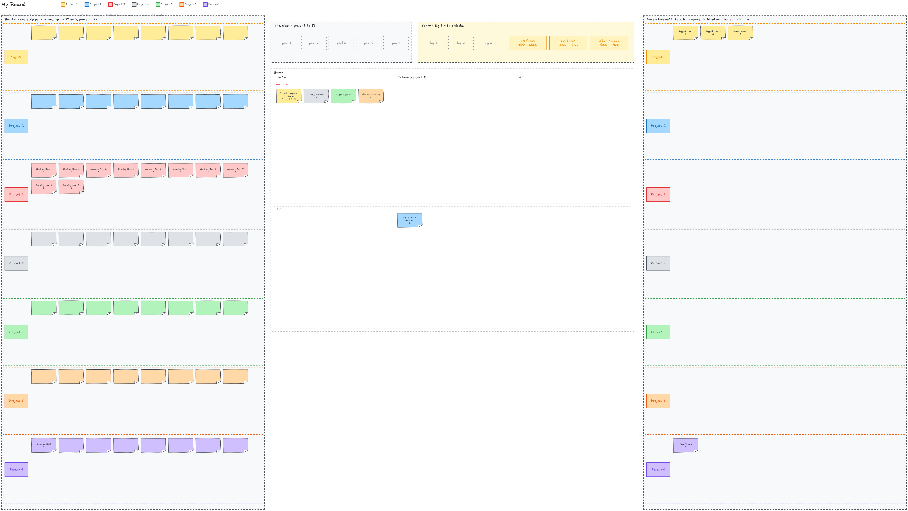

- Add a task from Claude Code: "add task Fix dbt snapshot for Project 1, size M". Or `node board/add-task.mjs --company p1 --title "Fix dbt snapshot" --size M`.
- `/board-plan-day` every morning picks the Big 3. `/board-week-review` on Friday archives Done and sets next week's goals.
- Drag stickies by hand in the app. Scripts only add; you move.

Details and rules: [`board/README.md`](board/README.md).

## Library packs: sticky notes and cloud icons

The app loads Excalidraw library packs from `libs/` into the library sidebar on start: sticky notes, AWS, Azure, GCP icons, and technology logos. Claude can stamp them too:

```bash
node libs/stamp.mjs list s3
node libs/stamp.mjs add --item "S3" --x 400 --y 200
```

Details: [`libs/README.md`](libs/README.md).

### Pack samples

Six items from each pack, rendered from the canvas.

**Sticky Notes (Post-it)** · `libs/post-it.excalidrawlib`

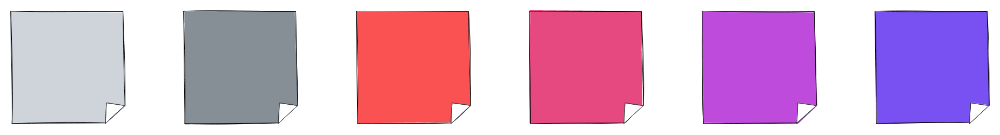

**Simple Sticky Notes** · `libs/simple-sticky-notes.excalidrawlib`

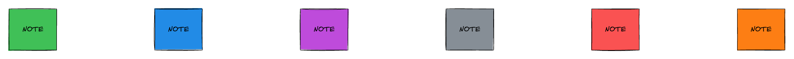

**AWS Architecture Icons** · `libs/aws-architecture-icons.excalidrawlib`

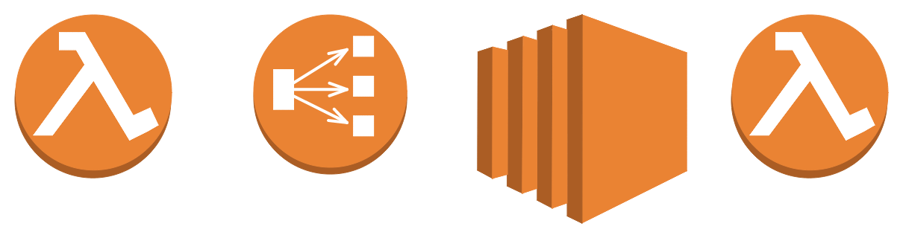

**AWS Serverless Icons v2** · `libs/aws-serverless-icons-v2.excalidrawlib`

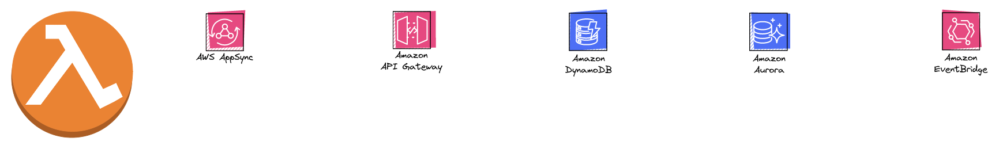

**Azure Compute** · `libs/azure-compute.excalidrawlib`

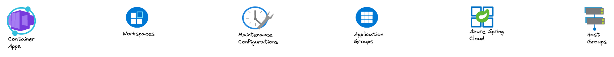

**Azure Storage** · `libs/azure-storage.excalidrawlib`

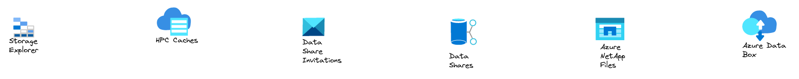

**Azure Network** · `libs/azure-network.excalidrawlib`

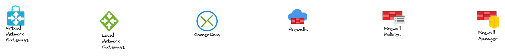

**Azure Containers** · `libs/azure-containers.excalidrawlib`

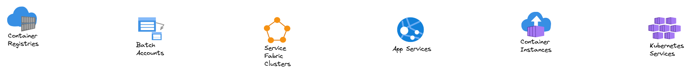

**Azure General** · `libs/azure-general.excalidrawlib`

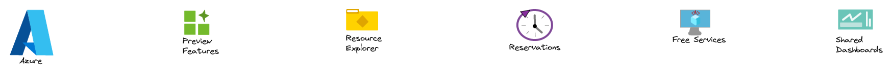

**GCP Icons** · `libs/gcp-icons.excalidrawlib`

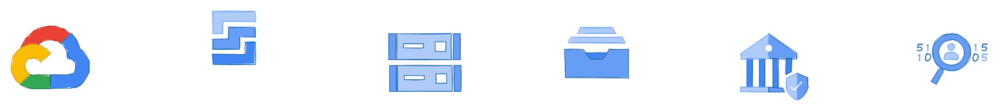

**Google Architecture Icons** · `libs/original-google-architecture-icons.excalidrawlib`

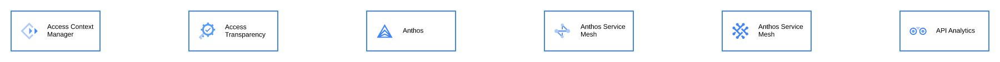

**Technology Logos** · `libs/technology-logos.excalidrawlib`

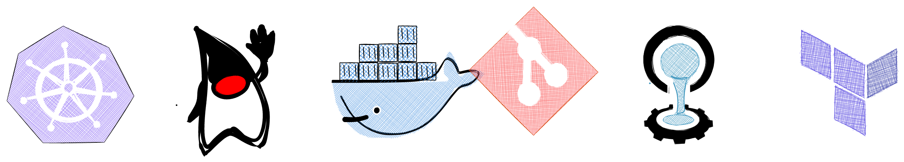

**Cloud Design Patterns** · `libs/cloud-design-patterns.excalidrawlib`

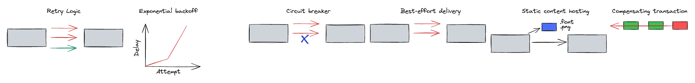

## Requirements

- macOS 12 or newer
- Node.js 20 or newer
- Xcode command line tools (`xcode-select --install`)
- Claude Code CLI (optional, for MCP registration)

## Install

```bash
git clone --recurse-submodules https://github.com/surfalytics/excalidraw-local.git
cd excalidraw-local
./setup.sh
```

Then open `Excalidraw.app`. Drag it to the Dock if you like.

Keep the repo outside `~/Desktop`, `~/Documents`, and `~/Downloads`. macOS blocks apps launched from Finder from reading those folders.

## Use

1. Open `Excalidraw.app`.
2. In Claude Code, ask: "Draw the architecture of this service in Excalidraw."
3. Shapes appear live in the app.
4. Ask Claude to export a `.excalidraw` file. Put project diagrams in the repo's `docs/`. Put others in `diagrams/`.
5. Save To in the app opens a normal macOS save dialog.

## Layout

| Path | What it is |
|---|---|
| `app-wrapper/` | Swift source, icon, plist, and `build.sh` for the native app |
| `mcp_excalidraw/` | Submodule. MCP server and live canvas. Fork of [yctimlin/mcp_excalidraw](https://github.com/yctimlin/mcp_excalidraw) |
| `excalidraw/` | Submodule. Excalidraw source. Fork of [excalidraw/excalidraw](https://github.com/excalidraw/excalidraw). Not needed at runtime |
| `canvas-data/` | Live canvas state. Git-ignored |
| `diagrams/` | Your personal diagrams and board archives. Git-ignored |
| `diagrams-examples/` | Sample diagrams shown in this README |
| `setup.sh` | One-time install |
| `update.sh` | Pull submodules and rebuild |

## Maintenance

| Task | Command |
|---|---|
| Update everything | `./update.sh` |
| Rebuild only the app | `./app-wrapper/build.sh` |
| Check MCP status | `claude mcp get excalidraw` |
| Stop a stuck canvas | `pkill -f "mcp_excalidraw/dist/server.js"` |
| Hack on Excalidraw itself | `./setup.sh --source` then `cd excalidraw && corepack yarn start` |

## Notes

- Port 3456 is used on purpose. Port 3000 is often taken. Change it in `app-wrapper/main.swift` and in `setup.sh` together.
- If the app is not open, the MCP server auto-starts the canvas itself. Both use the same `canvas-data/`.
- The app is ad-hoc signed. If macOS blocks it, right-click and choose Open once.
